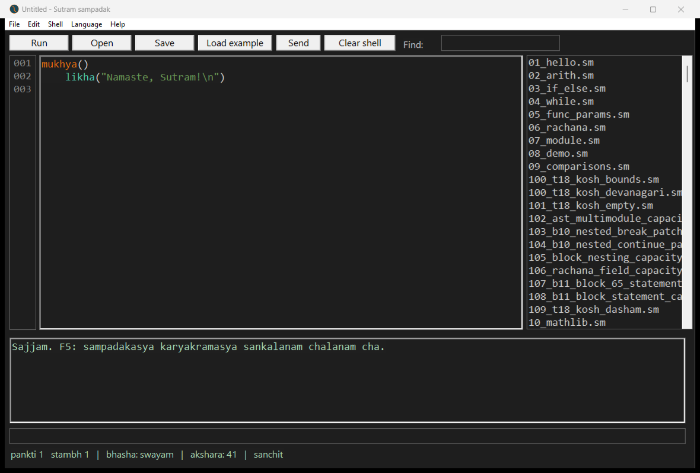
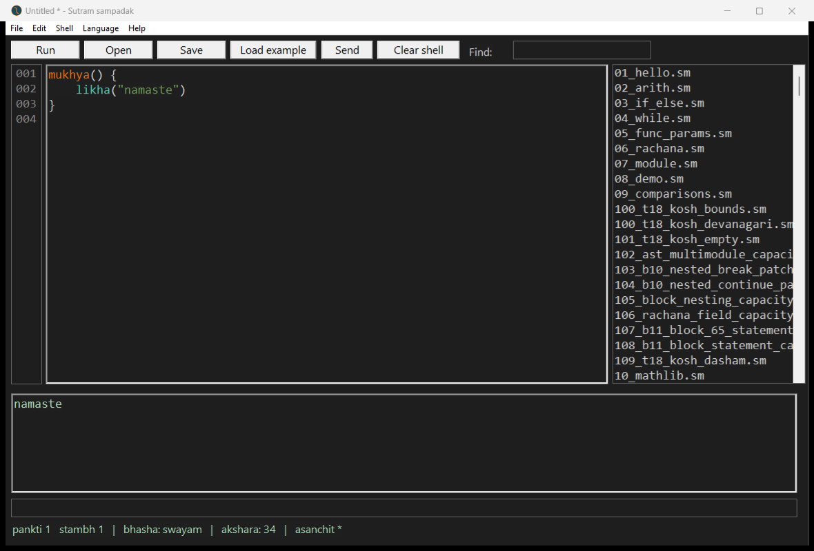
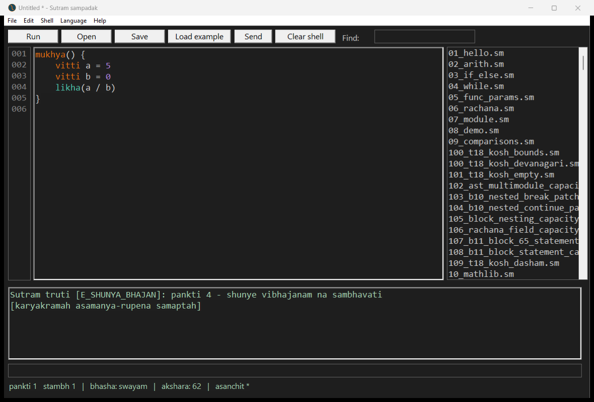
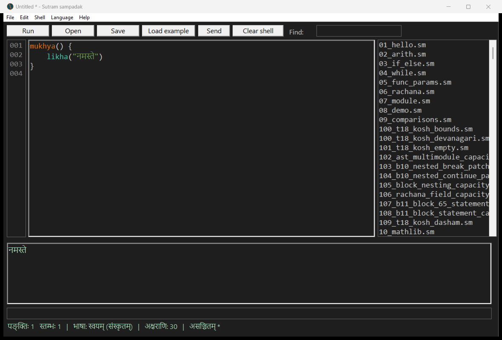

# Sarvam Windows acceptance sheet — v297 results

Executed 2026-11-03 against the exact examples from `SUTRAM-WINDOWS-TEST.md` supplied in Downloads. Request copy, exact program files, commands, separate stdout/stderr, exit codes, timings, and IDE screenshots are retained in `sarvam-acceptance-v297-2026-11-03/`.

## Outcome

**3 NOT-RUN**, **18 PASS**, **2 FAIL**, **1 UNEXPECTED**. No five-second hangs observed.

**Confirmed failures: tests 18 and 19.** Memory accounting stays zero and the allocation budget is not enforced. The string, naming/alias, arithmetic-refusal, withdrawn-function and Unicode-output tests passed.

Direct-compiler route (Route B semantics), using the already installed v297 binary rather than the repository-root binary. Installation, uninstall and a new desktop CMD session were not performed. The existing installation was preserved. This is not full installer acceptance. No tracked compiler, library, pack or golden was changed; only requested report/evidence files were created.

Windows: `Windows-11-10.0 (build redacted)-SP0`. Console/harness: Windows PowerShell 5.1 launcher; Python subprocess capture (developer harness only).
Compiler: `%USERPROFILE%\AppData\Local\Programs\Sutram\bin\sutram.exe`.
Compiler SHA-256: `ccc8368eb57e91da54a3bed5c824bf63892bc5f9329ff34bf5f16cc1d3a1370e`.

Exact full version output:
```text
Sutram 1.0 (v297) - sampurna sutra
Samskrita-mukhya bhasha -> x86-64 yantra-bhasha
```

## One row per requested test

| Test | Result | Actual output / notes |
|---|---|---|
| 1 — installer runs | NOT-RUN |  Direct compiler route; install/uninstall and fresh desktop CMD PATH acceptance not performed. |
| 2 — compiler version after install | PASS | Sutram 1.0 (v297) - sampurna sutra / Samskrita-mukhya bhasha -> x86-64 yantra-bhasha Full-path invocation; bare command PATH caveat below. |
| 3 — compiler is on PATH | NOT-RUN |  Direct compiler route; install/uninstall and fresh desktop CMD PATH acceptance not performed. |
| 4 — uninstall | NOT-RUN |  Direct compiler route; install/uninstall and fresh desktop CMD PATH acceptance not performed. |
| 5 — hello world | PASS | namaste  |
| 6 — compile a missing file | PASS | Sutram truti: nivesh patra aprapt  |
| 7 — string equality and inequality | PASS | eq: 1 / ne: 1  |
| 8 — string ordering | PASS | lt: 1 / gt: 0  |
| 9 — string concatenation | PASS | abcd  |
| 10 — `likha` with three arguments | PASS | 5 7  |
| 11 — the new `kosh` names | PASS | gan=2 / hri=20 / rikt=0  |
| 12 — old `kosh` names still work | PASS | 1 Runtime stdout=1; deprecation notices occur on compiler stderr, not compiler stdout. Streams below. |
| 13 — division by zero | PASS | Sutram truti [E_SHUNYA_BHAJAN]: pankti 4 - shunye vibhajanam na sambhavati  |
| 14 — decimal loop bound | PASS | loopbound.sm:2:22: Sutram truti [E_CHAKRA_DASHAM]: chakra purnankaih eva gananam karoti - dashama-sankhya na sambhavati /       chakra i = 0 tak 3.0 { /                        ^ / Sanket: chakra i = 0 tak 3 likhyatam; dashamaya yavat upayujyatam  |
| 15 — integer overflow refusal | PASS | Sutram truti [E_ATIPRAVAH]: dvigun: dvigunitam phalam purnanka-seemam atikramati; n -4611686018427387904 tah 4611686018427387903 paryantam bhavet.  |
| 16 — the same function on legitimate input | PASS | 10  |
| 17 — a different refusal code | PASS | Sutram truti [E_PHALA_SEEMA]: nirapeksh_mulya: nirapeksha-mulyam 9223372036854775808; purnankasya adhikatamam mulyam 9223372036854775807.  |
| 18 — memory reporting | FAIL | start=0 / in=0 / after=0 Expected in=4096; actual in=0. Exit 0. |
| 19 — memory budget refuses | FAIL | 200010000 Expected E_PARIMITA; instead prints the sum and exits 0. |
| 20 — withdrawn function | PASS | withdrawn.sm:4:11: Sutram truti [E_PRATYAHRITA]: sankhya_bindu (sankhya_dot) pratyahrita - asyah phalam ashuddham, sanshodhanam pratiksate /       likha(sankhya_bindu(a, a)) /             ^ / Sanket: dvayoh kosh dasham bindu-gunanaya: yoj sankhyiki, bindu_gunan(a, b) - laghutara dirghata eva pathyate  |
| 21 — Devanagari in output | PASS | नमस्ते Captured UTF-8 is correct; IDE screenshot visually confirms Devanagari. CMD font rendering not tested. |
| 22 — the IDE opens | PASS |  Installed IDE launched directly; Start Menu shortcut not exercised. |
| 23 — the IDE compiles and runs | PASS |  Exact supplied hello program run in installed IDE. |
| 24 — the IDE shows an error in Sanskrit | UNEXPECTED |  Correct Sanskrit error in Latin transliteration; this program emits no Devanagari. Separate test21 screenshot verifies Devanagari rendering in the IDE. |

## Findings and limitations

- **PATH collision:** the legacy `%LOCALAPPDATA%\Sutram\bin` precedes the new `%LOCALAPPDATA%\Programs\Sutram\bin` in the persisted user PATH. A supplementary CMD process with PATH reconstructed from machine and user settings was run; see `path-check.txt`. This is not a manually opened new desktop CMD session. Outside the repository root, it resolves the legacy executable and prints `Sutram 1.4.0`. Running CMD from the repository root instead finds the root v297 executable first, which masks this PATH collision. Full-path v297 results must not be confused with bare-command results.
- Existing install.log ends with installation complete, but this run did not witness the installer dialogs or test uninstall. The known v243 payload issue was not observed in the tested installed binary. The older legacy installation reports 1.4.0, a separate issue.
- Test24 emits Sanskrit in Latin transliteration. The sheet’s expectation of Devanagari from that exact program does not match its actual message. The separate Devanagari example renders visibly in the installed IDE.
- Single-string `likha` in tests 5, 9 and 21 prints the requested text without a trailing newline. An initial harness assumption added a newline; that assumption was corrected before final scoring. No program or golden was changed.
- An initial GUI-driver attempt reached the window before its controls were ready. Adding an 800 ms initialization wait allowed the requested GUI checks to complete. This is recorded as a harness startup issue, not a compiler crash.
- The sheet says indentation, not braces, but its programs use braces; the exact supplied brace-based programs were tested. The claim that Windows/IDE automation has never run is stale relative to the preceding 335-example report.
- Known withdrawn-function behavior and old linker diagnostic wording are not reported as new defects. No linker test was requested by this sheet.

## IDE screenshots

### Test 22



### Test 23



### Test 24



### Test 21



## Exact output and diagnostics

Empty streams are explicitly marked. Commands and elapsed times are in `final-results.json`.

### Test 1 — installer runs

### Test 2 — compiler version after install

run; exit: 0

stdout:
```text
Sutram 1.0 (v297) - sampurna sutra
Samskrita-mukhya bhasha -> x86-64 yantra-bhasha
```

stderr:
```text
(empty)
```

### Test 3 — compiler is on PATH

### Test 4 — uninstall

### Test 5 — hello world

compile; exit: 0

stdout:
```text
Siddh: 98 baait sankalit
```

stderr:
```text
(empty)
```

run; exit: 0

stdout:
```text
namaste
```

stderr:
```text
(empty)
```

### Test 6 — compile a missing file

compile; exit: 1

stdout:
```text
Sutram truti: nivesh patra aprapt
```

stderr:
```text
(empty)
```

### Test 7 — string equality and inequality

compile; exit: 0

stdout:
```text
Siddh: 554 baait sankalit
```

stderr:
```text
(empty)
```

run; exit: 0

stdout:
```text
eq: 1
ne: 1
```

stderr:
```text
(empty)
```

### Test 8 — string ordering

compile; exit: 0

stdout:
```text
Siddh: 548 baait sankalit
```

stderr:
```text
(empty)
```

run; exit: 0

stdout:
```text
lt: 1
gt: 0
```

stderr:
```text
(empty)
```

### Test 9 — string concatenation

compile; exit: 0

stdout:
```text
Siddh: 116 baait sankalit
```

stderr:
```text
(empty)
```

run; exit: 0

stdout:
```text
abcd
```

stderr:
```text
(empty)
```

### Test 10 — `likha` with three arguments

compile; exit: 0

stdout:
```text
Siddh: 376 baait sankalit
```

stderr:
```text
(empty)
```

run; exit: 0

stdout:
```text
5 7
```

stderr:
```text
(empty)
```

### Test 11 — the new `kosh` names

compile; exit: 0

stdout:
```text
Siddh: 1154 baait sankalit
```

stderr:
```text
(empty)
```

run; exit: 0

stdout:
```text
gan=2
hri=20
rikt=0
```

stderr:
```text
(empty)
```

### Test 12 — old `kosh` names still work

compile; exit: 0

stdout:
```text
Siddh: 463 baait sankalit
```

stderr:
```text
Sutram suchana: 'kosh_push' purana nama - 'kosh_kship' likhatu
Sutram suchana: 'kosh_len' purana nama - 'kosh_gan' likhatu
```

run; exit: 0

stdout:
```text
1
```

stderr:
```text
(empty)
```

### Test 13 — division by zero

compile; exit: 0

stdout:
```text
Siddh: 543 baait sankalit
```

stderr:
```text
(empty)
```

run; exit: 1

stdout:
```text
Sutram truti [E_SHUNYA_BHAJAN]: pankti 4 - shunye vibhajanam na sambhavati
```

stderr:
```text
(empty)
```

### Test 14 — decimal loop bound

compile; exit: 1

stdout:
```text
loopbound.sm:2:22: Sutram truti [E_CHAKRA_DASHAM]: chakra purnankaih eva gananam karoti - dashama-sankhya na sambhavati
      chakra i = 0 tak 3.0 {
                       ^
Sanket: chakra i = 0 tak 3 likhyatam; dashamaya yavat upayujyatam
```

stderr:
```text
(empty)
```

### Test 15 — integer overflow refusal

compile; exit: 0

stdout:
```text
Siddh: 7340 baait sankalit
```

stderr:
```text
(empty)
```

run; exit: 1

stdout:
```text
(empty)
```

stderr:
```text
Sutram truti [E_ATIPRAVAH]: dvigun: dvigunitam phalam purnanka-seemam atikramati; n -4611686018427387904 tah 4611686018427387903 paryantam bhavet.
```

### Test 16 — the same function on legitimate input

compile; exit: 0

stdout:
```text
Siddh: 7335 baait sankalit
```

stderr:
```text
(empty)
```

run; exit: 0

stdout:
```text
10
```

stderr:
```text
(empty)
```

### Test 17 — a different refusal code

compile; exit: 0

stdout:
```text
Siddh: 7340 baait sankalit
```

stderr:
```text
(empty)
```

run; exit: 1

stdout:
```text
(empty)
```

stderr:
```text
Sutram truti [E_PHALA_SEEMA]: nirapeksh_mulya: nirapeksha-mulyam 9223372036854775808; purnankasya adhikatamam mulyam 9223372036854775807.
```

### Test 18 — memory reporting

compile; exit: 0

stdout:
```text
Siddh: 635 baait sankalit
```

stderr:
```text
(empty)
```

run; exit: 0

stdout:
```text
start=0
in=0
after=0
```

stderr:
```text
(empty)
```

### Test 19 — memory budget refuses

compile; exit: 0

stdout:
```text
Siddh: 354 baait sankalit
```

stderr:
```text
(empty)
```

run; exit: 0

stdout:
```text
200010000
```

stderr:
```text
(empty)
```

### Test 20 — withdrawn function

compile; exit: 1

stdout:
```text
withdrawn.sm:4:11: Sutram truti [E_PRATYAHRITA]: sankhya_bindu (sankhya_dot) pratyahrita - asyah phalam ashuddham, sanshodhanam pratiksate
      likha(sankhya_bindu(a, a))
            ^
Sanket: dvayoh kosh dasham bindu-gunanaya: yoj sankhyiki, bindu_gunan(a, b) - laghutara dirghata eva pathyate
```

stderr:
```text
(empty)
```

### Test 21 — Devanagari in output

compile; exit: 0

stdout:
```text
Siddh: 109 baait sankalit
```

stderr:
```text
(empty)
```

run; exit: 0

stdout:
```text
नमस्ते
```

stderr:
```text
(empty)
```

gui; exit: not captured by GUI

output:
```text
नमस्ते
```

### Test 22 — the IDE opens

gui; exit: not captured by GUI

output:
```text
Installed IDE window opened
```

### Test 23 — the IDE compiles and runs

gui; exit: not captured by GUI

output:
```text
namaste
```

### Test 24 — the IDE shows an error in Sanskrit

gui; exit: not captured by GUI

output:
```text
Sutram truti [E_SHUNYA_BHAJAN]: pankti 4 - shunye vibhajanam na sambhavati
[karyakramah asamanya-rupena samaptah]
```

