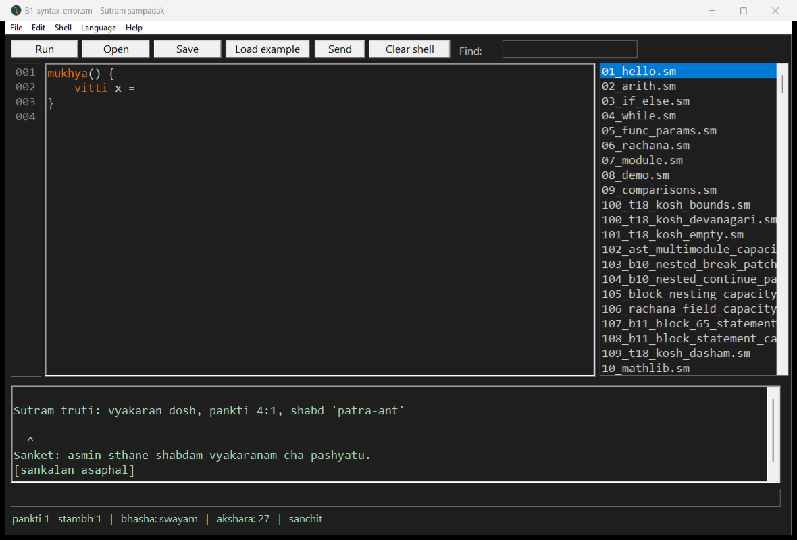
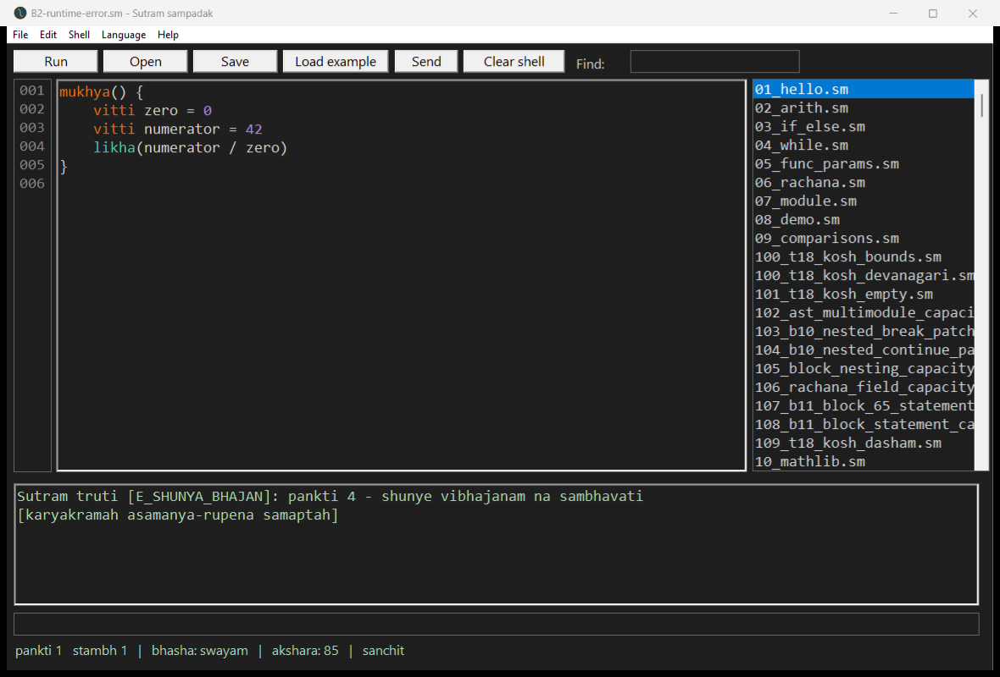
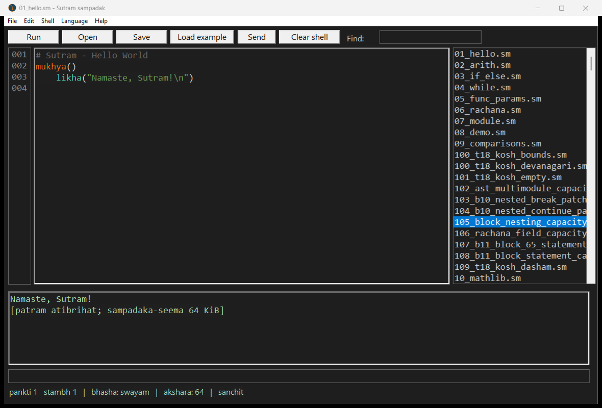
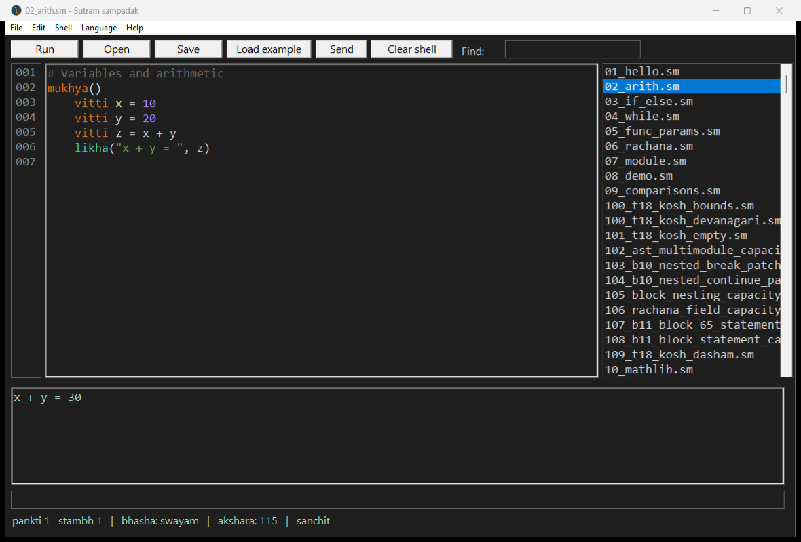

# v305 IDE: Run clears failures; file-load refusal retains stale content

The original native IDE was run against the original repository v305 compiler.
All three requested screenshots plus the large-file refusal were captured and
visually inspected. Full editor/title/output/status text before and after each
operation is in [ide.json](ide.json). No editor text was injected: the probes
were opened through the standard Open dialog; examples used the native list's
selection/load notification; Run used its normal command handler.

| Scenario | Observed result |
| --- | --- |
| B1: Hello, then load a syntax-error file and Run | Old Hello output is cleared. Only the syntax diagnostic and `[sankalan asaphal]` remain. |
| B2: Hello, then load division-by-zero and Run | Old Hello output is cleared. Only `E_SHUNYA_BHAJAN` and the abnormal-completion notice remain. |
| B3: Hello, then select the 70,422-byte example | Editor and title still identify Hello. Old Hello output remains, with the 64 KiB refusal appended. The list highlights the refused example. |
| B3 recovery: select `02_arith.sm`, then Run | The editor and title change to arithmetic immediately. Run clears the prior output/refusal and displays only `x + y = 30`. |

**The stale output does not persist through the tested compile/runtime failures.**
There is an intermediate distinction: merely opening another valid file retains
the previous output until Run, including during recovery from a large-file
refusal. The selected program is correct after that next load; it does not remain
stuck on the refused file. This is narrower than “every failure leaves stale
output,” and more precise than “the next click clears everything.”

The failed-load title restoration is also deliberate: retaining the previous
filename protects against saving its text over the refused file. A fix should
preserve that safeguard while making the failed load and retained text explicit.
Relevant source locations at the tested base: `load_file` at
`windows/gui/sutram_gui.asm:2627`, its `.too_big` branch at 2668,
`restore_prev_file` at 2808, `output_append` at 2818, and `run_editor` at 3210.
No source fix was made in this round.

## Screenshots

After compile error:

After runtime error:

After the known large-file refusal:

After selecting arithmetic and running:

The IDE closed normally after the run; no forced close was required. SHA-256
checks show Hello, arithmetic, and the oversized example were unchanged.
IDE SHA-256: `829f8658de55be045c6273339244d099022b373725ead3681228c00ba3d5c051`.
This is diagnostic evidence for these scenarios, not full IDE acceptance.
