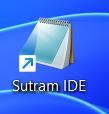

# Desktop shortcut collision

## C1 — count and ownership

Before installation, created this harmless user shortcut:

```text
C:\Users\dmech\OneDrive\Desktop\Sutram IDE.lnk
  target: C:\Windows\System32\notepad.exe
  arguments: (empty)
```

The installer desktop option was explicitly selected. After installation there was **one** matching desktop
shortcut across the user and common Desktop folders. Its SHA-256 was unchanged from the pre-install fixture;
its target remained Notepad. No second desktop shortcut was created.
Separately, the Start menu contained one `Sutram IDE.lnk` pointing at the correct installed GUI.
Thus there are two IDE-named links across those two locations, not two side-by-side on the Desktop.

The engine log records:

```text
A pre-existing user desktop shortcut named Sutram IDE.lnk was preserved.
```

There is no collision warning in the captured visible wizard pages. Finish reports successful installation
and points to the Start menu. Preservation is correct; the notice is only in `install.log`.

Evidence: [shortcut targets/hashes](shortcuts.json), [before hash](preserve.json),
[engine log](install-engine.log), [Finish](install-finish.png).

## C2 — actual desktop click



The screenshot is an unaltered screen-region capture around the actual Desktop icon; unrelated personal
desktop content was excluded. The visible label is **Sutram IDE**, with Notepad's icon.
An actual double-click opened Windows **Notepad.exe**, verified by the new window and process executable.
Notepad restored its existing session; its document contents were not edited or published. The test-created
Notepad window was subsequently closed normally.

**FAIL for the first-click expectation:** a user selecting the only desktop item labelled Sutram IDE opens
another application. The observed wrong target supports a usability finding; no human confusion study was run.
The correct Start-menu IDE remains available.

Additional visible mismatch: the installer checkbox reads **“Create a desktop shortcut (Sutram Terminal)”**,
but the engine manages **Sutram IDE.lnk**. The [options screenshot](install-options-default.png) records it.

See [desktop click record](desktop-click.json) and [final window cleanup](finish.json).
The collision shortcut was moved into local preservation storage after testing, not deleted.
