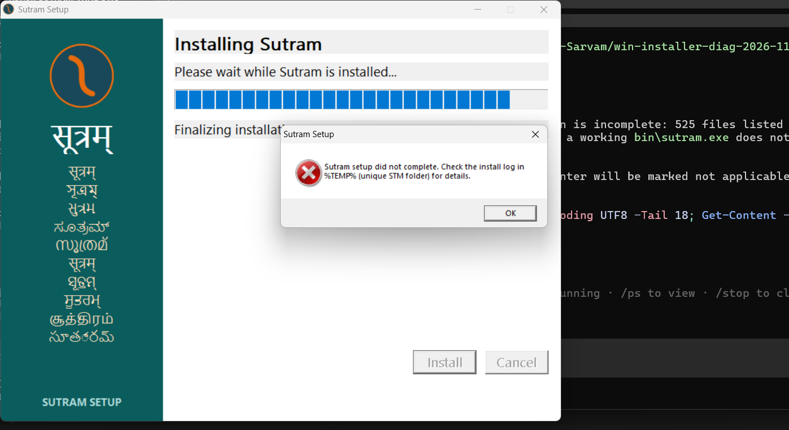
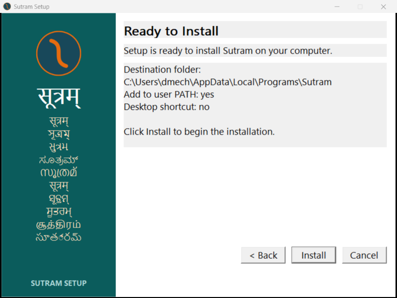

# Current installer: two failed upgrades before the earlier copy-stage hang

**Installation did not complete. The earlier copy-stage hang was not reproduced
in this machine's current state.** Both attempts instead reach the same ownership
guard, log an error, and exit the installer PowerShell child. No installation
repair, ownership bypass, uninstall, source change, or compiler-probe rerun was
performed. The owner also supplied a screenshot of the actual failure dialog.

Base: main `f77a7464`. Current `Sutram-Setup.exe` SHA-256:
`99d26a89f355a2b20bdf7fe1fbd94aa8e304c3eae3a9b54c8364ecf8f1e6e6f5`.
This is the original v305 package, not a v306 or PR #66 build.

| Question | Measured answer |
| --- | --- |
| Does it hang at the same point every time? | No current hang established. Two attempts refuse at the same pre-copy ownership check; both PowerShell children are absent by the 10-second observation and remain absent at 70 seconds. |
| Last line of transcript | The raw final line is the transcript closing delimiter. Last diagnostic message: `Observation result: CHILD_EXITED_WITHOUT_HANG`. The installer error is in the separate engine log, below. |
| Command line of stuck process | No stuck PowerShell exists in these attempts. The retry's live child command line was captured at one second, verbatim below. |
| Does Enter complete it? | NOT APPLICABLE: PowerShell already exited. No key was injected. |
| Does Y + Enter complete it? | NOT APPLICABLE for the same reason. No key was injected. |
| Is bin/sutram.exe present and correct? | Present and prints v305, but already present before these attempts and does not match the current package hash. Full installation is incomplete. |
| Machine PATH entry? | None containing Sutram; exact registry value unchanged. |
| User PATH entry? | Canonical Programs/Sutram/bin at position 20 (one-based); already present before these attempts, unchanged afterward. |
| Requires elevation? | Both runs launched from a non-elevated token and reached extraction/self-tests/ownership refusal without a UAC approval. No UAC prompt was observed; a fresh-install success is not claimed. |

## Actual failure location

Attempt 1 engine log, 20:39:19 local:

```text
ERROR: Upgrade would overwrite a user file; preserve it elsewhere first: %USERPROFILE%\AppData\Local\Programs\Sutram\bin\sutram-link.exe
```

Retry engine log, 20:42:30 local: the identical error. The retry started its
engine at 20:42:21, extracted the payload, and passed its own pre-install
`--version` and `--help` checks before refusing. See [first log](attempt1/engine.log)
and [retry log](engine.log). Neither reached `Copying Sutram files.`

The installed linker's hash is
`b6c722e9172440d1f352d2e01ba0564fc46a618e909c04f5c072103c666d910e`;
the existing installation manifest expects
`84d653fbefbc674721ecb7cf9dcde816ab871227d6dd8b1c59ca8254a9cc3c5d`.
The guard interprets the difference as a user-file conflict. A mismatch does
not establish who changed it or when. The files were already in this state at
the first before-snapshot and did not change during either diagnostic attempt.

The extracted engine matches `windows/native-installer/install-core.ps1` after
normalizing the UTF-8 BOM/line endings. The refusal is the upgrade-manifest
check around line 308; the copy log is later, at line 321. This identifies the
current refusal. It does **not** identify the original v303 copy stall.

The wizard posts 90-percent/finalizing progress immediately after the child
exits, before checking its exit status (`sutram_wizard.asm` around 1147).
Therefore the owner's nearly full progress bar is not evidence of completion.
On failure it shows the error dialog and returns to Ready after dismissal.
The later automated screenshot shows that Ready state.

## Process command line (live retry child, not a stuck process)

PID 36032; parent wizard PID 25936:

```text
powershell.exe -NoProfile -File "%USERPROFILE%\AppData\Local\Temp\STMC098.tmp\install-core.ps1" -PayloadZip "%USERPROFILE%\AppData\Local\Temp\STMC098.tmp\payload.zip" -InstallDir "%USERPROFILE%\AppData\Local\Programs\Sutram" -SetupExePath "<repo>\Sutram-Setup.exe" -LogPath "%USERPROFILE%\AppData\Local\Temp\STMC098.tmp\install.log" -AddPath
```

Process IDs, parents, start times and CPU observations are preserved in
[installer.json](installer.json) and [attempt 1](attempt1/installer.json).
The only PowerShell remaining at later observations was the diagnostic wrapper,
not an installer child. Both recorded wizard processes had exited when cleanup
was checked; no residual processes were killed ([cleanup.json](cleanup.json)).

Command lines identify the script and its arguments, **not its current executing
line**. Likewise, a transcript in the parent PowerShell does not automatically
capture output from a child with its own console or every swallowed exception.
We retained the parent transcript, read the child's console buffer at one second
(empty), captured engine logs separately, and did not infer a line from argv.
The raw transcript is [transcript.txt](transcript.txt); its exact last 30 lines
are [transcript-tail.txt](transcript-tail.txt).

## Screenshots

Owner-captured failure dialog at 20:43:21 local, preserved without alteration:

 *(screenshot removed under the privacy rule, 9 November 2026; the text keeps what it showed)*

Automated observation after the wait, showing the wizard back at Ready:

 *(screenshot removed under the privacy rule, 9 November 2026; the text keeps what it showed)*

No stuck PowerShell/input-prompt screenshot is fabricated: those conditions were
not present in the measured attempts. Enter/Y input could not diagnose an
already-exited child. An OK error dialog is an acknowledgment, not a prompt that
can make the failed installation succeed.

## What remains unresolved

The current partial installation prevents reaching the earlier copy-stage stall.
A clean-state reproduction remains necessary, using a disposable standard-user
Windows environment or an explicitly approved recovery that preserves the
existing files. Neither was performed under this diagnostic-only instruction.
Do not bypass ownership checks or delete the current installation to force a
result. The prior log ending at `Copying Sutram files.` remains evidence of the
earlier attempt, not a result newly reproduced here.

The installer writes user PATH through HKCU in its source; it does not write
machine PATH. This failed upgrade did not reach that write, so this round proves
the before/after scope state, not fresh-install PATH behavior. Contrary to a
recent read-only report, earlier native logs placed both old/new Sutram entries
in **user** PATH; a machine entry must not be inferred from the retired NSIS recipe.

## Exact last 30 transcript lines

```text
Windows PowerShell transcript start
Start time: 20261106204218
Username: <machine>\<user>
RunAs User: <machine>\<user>
Configuration Name: 
Machine: <machine> (Microsoft Windows NT 10.0 (build redacted))
Host Application: c:\windows\system32\windowspowershell\v1.0\powershell.exe -Command try { [Console]::OutputEncoding=[System.Text.Encoding]::UTF8 } catch {}
& .\Windows-to-Sarvam\win-installer-diag-2026-11-06\run.ps1
Process ID: 19552
PSVersion: 5.1 (build redacted)
PSEdition: Desktop
PSCompatibleVersions: 1.0, 2.0, 3.0, 4.0, 5.0, 5.1 (build redacted)
BuildVersion: 10.0 (build redacted)
CLRVersion: 4.0.30319.42000
WSManStackVersion: 3.0
PSRemotingProtocolVersion: 2.3
SerializationVersion: 1.1.0.1
**********************
Transcript started, output file is <repo>\Windows-to-Sarvam\win-installer-diag-2026-11-06\transcript.txt
Snapshot before saved; installed files: 137
Starting current installer <repo>\Sutram-Setup.exe; SHA256 99D26A89F355A2B20BDF7FE1FBD94AA8E304C3EAE3A9B54C8364ECF8F1E6E6F5; unelevated.
Installer child PID 36032: powershell.exe -NoProfile -File "%USERPROFILE%\AppData\Local\Temp\STMC098.tmp\install-core.ps1" -PayloadZip "%USERPROFILE%\AppData\Local\Temp\STMC098.tmp\payload.zip" -InstallDir "%USERPROFILE%\AppData\Local\Programs\Sutram" -SetupExePath "<repo>\Sutram-Setup.exe" -LogPath "%USERPROFILE%\AppData\Local\Temp\STMC098.tmp\install.log" -AddPath

Observing for another 60 seconds without input.
Snapshot after saved; installed files: 137
Observation result: CHILD_EXITED_WITHOUT_HANG
**********************
Windows PowerShell transcript end
End time: 20261106204332
**********************
```
