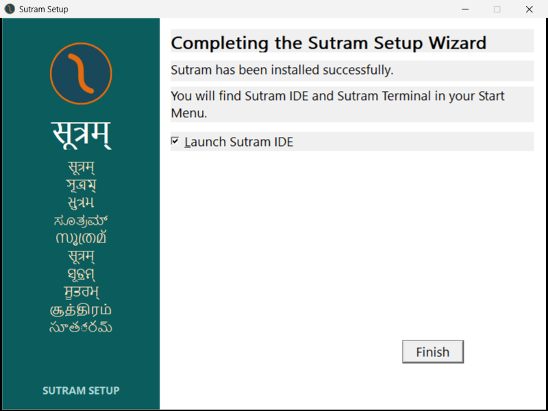
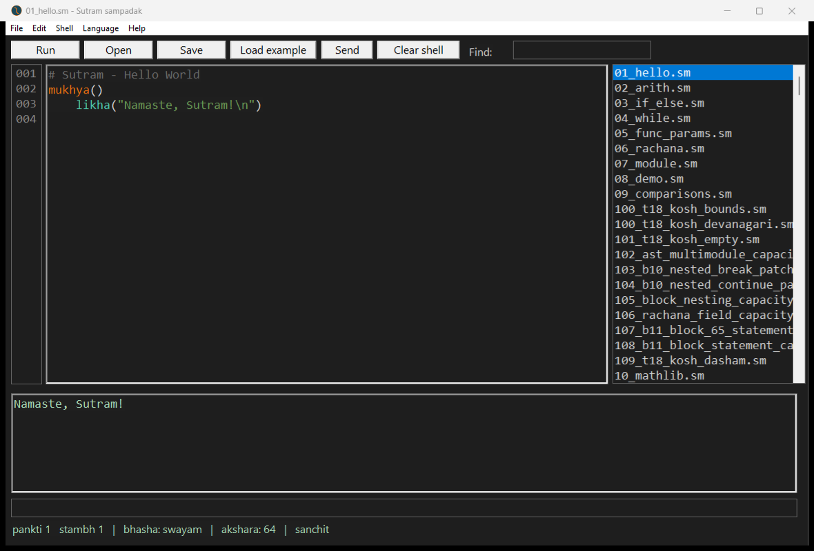
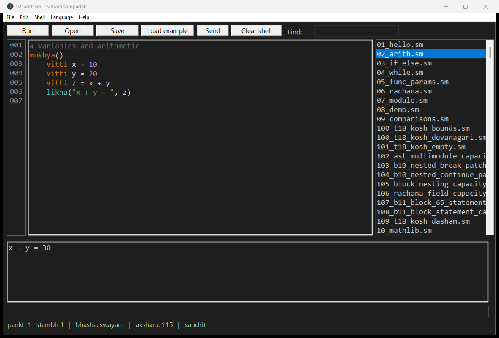

# Owner-authorized installation repair: completed and verified

The user authorized repair after the installer diagnostic. The incomplete
installation was preserved, then the **unchanged current v305 installer** was
run into the empty canonical location. It completed, reached **Finish**, and
closed normally. Its PowerShell child exited; no manual console closure or
Enter/Y input was needed.

Base repository commit: `9ae1b120`. Installer SHA-256:
`99d26a89f355a2b20bdf7fe1fbd94aa8e304c3eae3a9b54c8364ecf8f1e6e6f5`.
No product code, compiler binary in the repository, library, golden, workflow,
or security policy was changed. The unaccepted OOM candidate was not installed.

## Preservation and repair

All **137 existing files** were moved intact to:

```text
%USERPROFILE%\AppData\Local\Programs\Sutram-recovery-20261106-205221
```

Source/destination absolute paths and all ancestor/content reparse checks were
validated before the move. File hashes were checked after the move and again
during final verification. No original file was deleted or overwritten. The
backup is retained locally, not uploaded as executable content.

The current installer then installed into:

```text
%USERPROFILE%\AppData\Local\Programs\Sutram
```

It ran unelevated, with Add to user PATH and Desktop Shortcut selected. Existing
shortcuts were preserved by its own policy. Its log records copying at 20:52:46,
post-install version success at 20:52:47, and installation complete at 20:52:47
local time. The automation observed Finish after **14.9 seconds** from starting
the install-page wait. Timing is one observation, not a performance guarantee.

See [backup record](backup.json), [installer observations](install.json),
[engine log](engine.log), and [transcript](install-transcript.txt).

 *(screenshot removed under the privacy rule, 9 November 2026; the text keeps what it showed)*

## Verification results

| Check | Result |
| --- | --- |
| Current payload manifest | **657 of 657 files present and hash-matching**, zero failures |
| Installed compiler | SHA-256 `db5eda53871aafa4749d593ddef2d29e2841e3eb4d3cb7cdf680223fb45a073c`, matching the package |
| Installed IDE | SHA-256 `829f8658de55be045c6273339244d099022b373725ead3681228c00ba3d5c051`, matching the package |
| Installed uninstaller | Hash matches the setup executable and new ownership record |
| Bare `sutram` from unrelated CWD, persisted PATH | Resolves only the canonical installed `bin\sutram.exe`; v305, exit 0 |
| Installed Hello compilation/execution | exit 0, `Namaste, Sutram!` |
| Installed arithmetic compilation/execution | exit 0, `x + y = 30` |
| Installed `79_ayojan_cwd`, unrelated CWD | exit 0, `81`; installed adjacent library layout works |
| Existing desktop shortcut | Launches the repaired installed IDE |
| Installed IDE Hello and arithmetic | Both execute correctly; screenshots captured and inspected |
| Installer and test IDE closure | Normal closure, no forced close |
| Original backup | All 137 files still intact |
| Machine/user PATH | Both exactly unchanged; canonical user entry already existed |
| HKCU uninstall registration | Restored with correct canonical install/uninstall locations |

Every manifest entry and native command/output is in
[verification.json](verification.json). [ide.json](ide.json) records the actual
desktop-shortcut launch, source/title/output text and normal close.

 *(screenshot removed under the privacy rule, 9 November 2026; the text keeps what it showed)*

 *(screenshot removed under the privacy rule, 9 November 2026; the text keeps what it showed)*

The broad before/after snapshots execute their PATH queries from the repository
root, where a `sutram.exe` can also be found by Windows' current-directory search.
The acceptance result above deliberately uses a separate scratch CWD and an
environment reconstructed from persisted machine/user PATH. Its `where.exe`
result has only the canonical installed compiler; this avoids confusing CWD
precedence with a stale PATH entry.

## Remaining product issues and limits

This **repairs this machine's installation**. It does not fix or claim to have
isolated the historical v303 interrupted-copy hang. Fresh v305 installation
completed; the previous ownership-refusal scenario was avoided by preserving
the partial tree before installing, not by weakening the ownership guard.
Automatic recovery from partial upgrades is still a product issue for review.

The v305 runtime's known OOM behavior and the IDE's large-file stale-output
behavior remain as previously measured. The runtime candidate remains in
[draft PR #66](https://github.com/dap2810/Sutram/pull/66), pending independent
acceptance. No v306 was built or installed. This is not general v1.0 release
acceptance, and no full compiler suite was rerun for this machine-state repair.

The installer still registers DisplayVersion `0.1.0`, despite the compiler's
v305 banner. Existing PATH and shortcut entries were treated as pre-existing:
the new state says `PathOwned=0`, `DesktopOwned=0`, `OwnedShortcuts=`. They work,
but a later uninstall may intentionally preserve them. The backup and these
ownership details must be considered before any future cleanup. The uninstaller
was hash/registration checked, **not executed**, so this round does not claim
uninstall acceptance.

Keep the recovery directory until the owner decides it is no longer needed.
Do not run the old uninstaller inside the backup. It contains old metadata and
is evidence/rollback material, not a second active installation.

## Exact actions

From the repository root in an unelevated PowerShell:

```powershell
& .\Windows-to-Sarvam\win-repair-2026-11-06\preserve.ps1
& .\Windows-to-Sarvam\win-repair-2026-11-06\install.ps1
python Windows-to-Sarvam/win-repair-2026-11-06/verify.py
& .\Windows-to-Sarvam\win-repair-2026-11-06\ide.ps1
```

`preserve.ps1` is intentionally single-use and refuses an existing backup record.
Its first invocation stopped before the move because hidden AppData inspection
needed `Get-Item -Force`; that diagnostic-script issue was corrected before the
successful move. `install.ps1` refuses a nonempty canonical destination at entry.
Other scripts/helpers are retained alongside the logs. `snapshot.ps1` captures
registry values and files without changing persisted PATH.

The raw transcript retains PowerShell's trailing blank on the empty
`Configuration Name:` field. For committing captured transcripts, use the
command-local whitespace check `git -c core.whitespace=-blank-at-eol diff --cached --check`;
no repository setting or golden is changed. No CI was launched.
