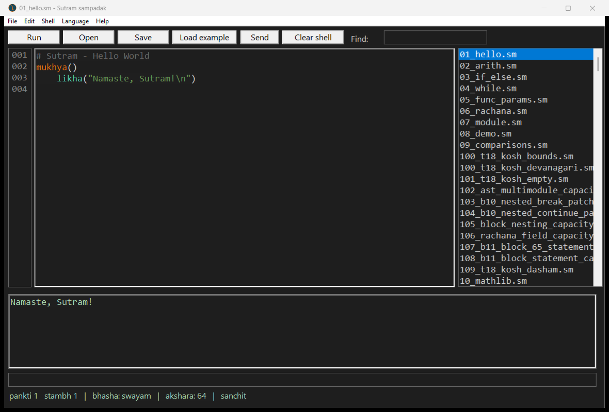
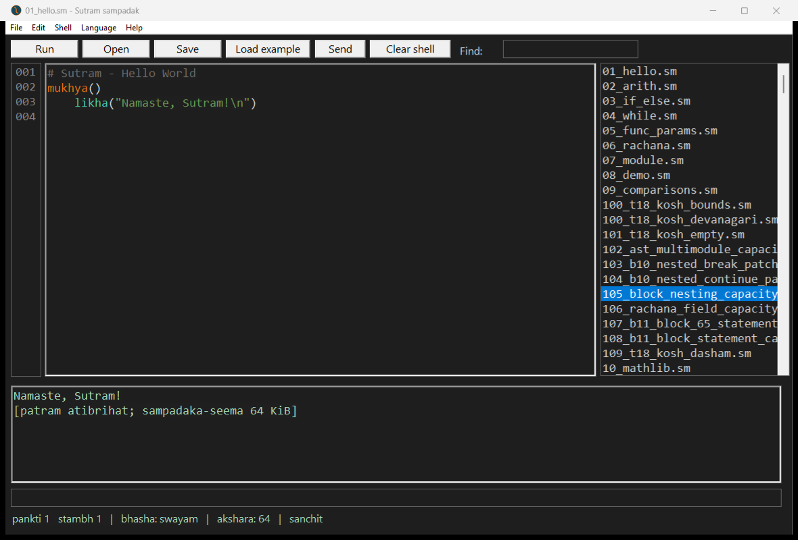

# Native Windows v305: compiler tested; OOM crash and known IDE defect remain

**Not release-accepted.** The requested direct compiler tests ran on native
Windows after removal of the conflicting v1.4.0 installation. Ordinary memory
and parameter-growth probes passed, and targeted v305 slice regressions passed.
However, **B3 crashes with access violation `0xC0000005` under a Windows Job
per-process commit limit**, instead of emitting the expected error. The known
IDE oversized-file refusal still leaves the previous program's output visible.

**No v305 installer was run.** The remaining installed compiler is v303; all
Part B and C compiler execution used the repository v305 compiler, not PATH.
The cleanup's final audit also found an unrelated Codex PATH entry missing;
it was restored to its original position. The final user PATH differs from
the original only by removal of the old Sutram entry; machine PATH is unchanged.

## Pinned identity

- Test date: 2026-11-06; native Windows build 26100, x64.
- Checkout: `7db8e24db956d5f3ec94f014f5ec4be532b0419c`.
- Fetched main: `cb443c2a0e4c3cfe3beabef375143c46b3f72e4a`. Its only changes from
  the checkout were two partner briefs; compiler, IDE, library, tests, examples,
  and goldens were identical. Product binaries came from v305 commit `c7168137`.
- Compiler: `E:\Github_Projects\Sutram\win\sutram.exe`.
- Compiler SHA-256: `db5eda53871aafa4749d593ddef2d29e2841e3eb4d3cb7cdf680223fb45a073c`.
- IDE SHA-256: `829f8658de55be045c6273339244d099022b373725ead3681228c00ba3d5c051`.
- Direct `--version`, exit 0:

```text
Sutram 1.0 (v305) - sampurna sutra
Samskrita-mukhya bhasha -> x86-64 yantra-bhasha
```

## Requested checks

| Test | Expected | Actual | Pass? |
|---|---|---|---|
| A1 PATH audit | recorded | Full inherited/persisted PATH, registry scopes, both executable hashes and versions recorded | PASS |
| A2 old install removed | one remains | Own uninstaller ran; its leftover executable, empty directory, and stale user PATH entry removed | PASS |
| A3 one command remains | exactly one | `%LOCALAPPDATA%\Programs\Sutram\bin\sutram.exe`, v303 | PASS |
| B1 alias across growth | `a0=99 k0=99` | `a0=99 k0=99`, exit 0 | PASS |
| B2 20,000 koshes | `sum=20000` | `sum=20000`, exit 0 | PASS |
| B3 out of memory | message, exit 1 | Unrestricted: `100000000`, exit 0; with 64/128/256 MiB commit limits: access violation, no message | FAIL under bounded memory |
| B4 `parimana()` | `in=4096` | `start=0`, `in=4096`, `after=0`, exit 0 | PASS |
| B5 budget | `E_PARIMITA` | `E_PARIMITA`, exit 1, budget 1048576 | PASS |
| B6 parameter grows | `gan=2` | `gan=2`, exit 0 | PASS |
| B7 slice then growth | refusal or correct length | Supplied `k[1 tak]`: syntax error; corrected `k[1:]`: `E_KOSH_VIBHAG`; exact S2 probes print `8`, `2`, `0` | Supplied probe inconclusive; corrected and regression probes PASS |
| B8 `anka_akshar(66)` | `B` | `B`, exit 0, no trailing newline | PASS |
| B9 native suite | same or better than 312/0 | 321 PASS, 1 COMPILE_FAIL, 3 NO_EXPECTATION, 6 SKIP | Not all green; library-layout failure isolated below |
| C IDE runs a program | output appears | Hello World prints `Namaste, Sutram!` through repository IDE | PASS |
| C IDE 64 KiB file | refuses AND clears output | Refuses 70,422-byte example, appends warning after old output | FAIL, known defect reproduced |

## New observed failure: memory pressure bypasses the graceful OOM path

The brief's unmodified B3 program allocated and filled 100,000,000 elements on
this host in 0.5003 seconds, printing `100000000` and exiting 0. This is not an
OOM test on an unconstrained machine with enough available commit.

The same generated executable, SHA-256
`61c3928c8c34a5612ee5fcb6873f56710b5a92869b6510b0f6062e3913c0dcf2`, was then run
under a **per-process Windows Job commit limit**. The child was created suspended,
assigned to the job, and resumed. No source or executable bytes were changed,
and the limit applies only to the child. Every run had a 60-second timeout.

| Program | Commit limit | Exit | stdout / stderr | Seconds |
|---|---:|---:|---|---:|
| B3 | 64 MiB | 3221225477 (`0xC0000005`) | both empty | 0.0901 |
| B3 | 128 MiB | 3221225477 (`0xC0000005`) | both empty | 0.1562 |
| B3 | 256 MiB | 3221225477 (`0xC0000005`) | both empty | 0.1785 |
| B3, same runner | 2048 MiB | 0 | `100000000` | 0.4442 |
| B2, same runner | 128 MiB | 0 | `sum=20000` | 0.0301 |

No run timed out. These controls distinguish the failure from a runner that
cannot launch the native program. Timings are single observations, not benchmarks.

**Read-side explanation, not a traced fault location:**
[`win/winrt_blob.asm`, `rt_veh`](https://github.com/dap2810/Sutram/blob/7db8e24db956d5f3ec94f014f5ec4be532b0419c/win/winrt_blob.asm#L234) commits reserved
pages on first touch. If `VirtualAlloc(MEM_COMMIT)` returns zero, lines 273-279
return `EXCEPTION_CONTINUE_SEARCH`, leaving the access violation unhandled.
This is consistent with the observations and explains why a reservation can
succeed while a later memory write never reaches the ordinary allocation-error
message. No debugger stack or faulting instruction was captured, so the exact
crash site is not claimed as proved.

A separate attempt to use the repository's `--fail-alloc 3` probe was refused
by the native compiler with `Sutram truti: nivesh patra aprapt`, exit 1. Inspection
shows that option's argument parsing is inside `%ifndef WINDOWS` at
`src/sutram_compiler.asm:2767`. It did not test OOM and is retained as a failed
test-infrastructure attempt; the Job-limited execution above is the native evidence.

## Slice and builtin details

The exact B7 handoff program is retained. Its output begins:

```text
Sutram truti: vyakaran dosh, pankti 6:19, shabd 'tak'
      vitti s = k[1 tak]
```

A syntax rejection does not demonstrate that the v305 endpoint defect is fixed.
Changing only the slice spelling to `k[1:]` produces the intended
`E_KOSH_VIBHAG` refusal for keeping a kosh-derived slice in a variable. Three
existing R127/R129 regression sources were copied verbatim into evidence and run
natively: an omitted upper bound after a lower-bound expression grows, shrinks,
or clears the kosh prints **`8`, `2`, and `0`**, respectively, all exit 0.

The exact R204 S1 argument-evaluation probe is refused with `E_KOSH_VIBHAG`, exit
1, and no output executable. This is stronger evidence than the malformed B7
source. All supplemental sources and outputs are retained.

Also checked: `anka_akshar(97)` prints `a`, exit 0. `vartani_sandhi` with literal
strings refuses at runtime with `E_VARTANI_STHIRA`, exit 1, stderr diagnostic and
empty stdout; no access violation. This is an allowed outcome in the prior brief.

## Native suite: preserve the raw failure

The existing `tools/test_windows_native.py` was executed with only its generated
output directory redirected to an isolated scratch folder. Compiler path,
sources, expectations, stdin fixtures, skip policy, and timeouts were unchanged.
It finished in 26.559 seconds: **321 PASS / 1 COMPILE_FAIL / 3 NO_EXPECTATION /
1 SKIP_LINUX_RAW_SYSCALL / 5 SKIP_SIDE_EFFECT_OR_INLINE_ASM**, 331 records total.

The sole failure was `79_ayojan_cwd`:

```text
Sutram truti [E_MODULE_MISSING]: yoj patra aprapt: ganit
Sanket: naam.smlib lib/ madhye srota-patrasya nirdeshikayam va bhavet
```

This test deliberately compiles from a non-project working directory. The direct
repository executable lives in `win/`, which has no adjacent `lib/` directory.
The resolver checks the source's `lib/`, compiler's `lib/`, then CWD's `lib/`.
Two focused controls both compile and print `81`, exit 0:

1. The original `win/sutram.exe`, with the project root as CWD.
2. A byte-identical compiler copy with byte-verified copies of the repository
   libraries beside it, with an unrelated CWD.

No library or harness change was made to hide the initial result. This isolates
the observed failure to the direct-test directory layout. **The raw full-suite
count remains 321/1; a 322/0 full rerun is not claimed.** The one failed case
passes separately in the complete portable layout.

No expectations: `215_r12_wordfreq`, `216_r12_expr`, `219_sanskrit_kosh_aliases`.
Skipped: `29_nishkriya` (Linux raw syscall); `217_r12_report`, `245_r18_netsock`,
`270_r75_nested_store`, `348_r126_kosh_then_raw`, `349_r126_kosh_in_one_branch`
(existing harness side-effect/inline-assembly filter). Skips are not passes.

## IDE evidence

The real repository IDE loaded `01_hello.sm` from its example list and executed
it through its Run command. It then attempted to load
`105_block_nesting_capacity.sm` (70,422 bytes). The editor and title stayed on
Hello World; the output became:

```text
Namaste, Sutram!
[patram atibrihat; sampadaka-seema 64 KiB]
```

The warning was appended, so the previous output was **not cleared**. This is
the known v297 usability defect, reproduced rather than reported as new. The
oversized file's SHA-256 was unchanged before and after, and the IDE closed on
request without forced termination.





## Delivery and limits

See [ENVIRONMENT.md](ENVIRONMENT.md), [COMMANDS.md](COMMANDS.md),
[identity.json](identity.json), [probes.json](probes.json),
[native-cases.json](native-cases.json), [followups.json](followups.json),
and the `oom-*.json` files. Reports, logs, and screenshots are documentation-only
on main. Every `.sm` probe and the exact automation are in this same folder on
review branch `codex/windows-v305-2026-11-06`, pending independent acceptance.

No compiler, runtime, library, existing examples, goldens, or workflows were
modified, and no CI run was triggered. No installer acceptance is claimed.
The newly observed bounded-memory access violation needs investigation before
claiming graceful Windows OOM behavior; the existing IDE output-clearing defect
also remains open.
