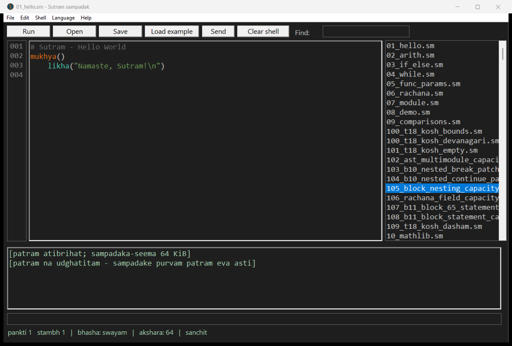
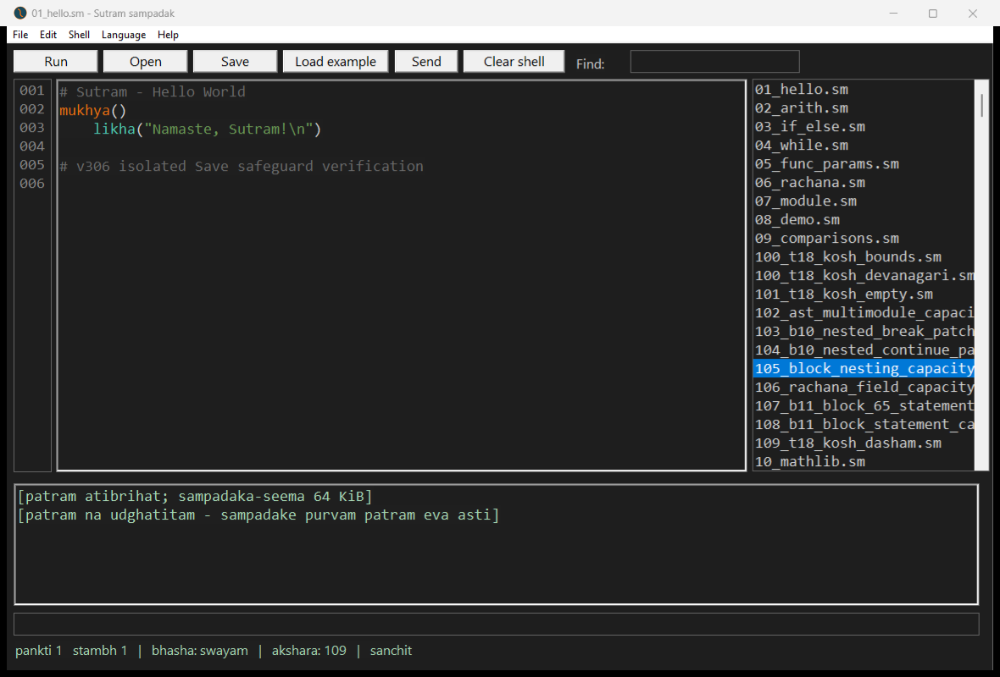

# v306 native IDE: refused load and Save safeguard pass

The installed IDE bundle was copied to a fresh isolated directory under
`build/windows-v306-2026-11-06/ide-save-guard`. Its executable hash matches the
installed v306 IDE. Save was exercised on those copies only.

1. Loaded `01_hello.sm` through the native example list and invoked Run.
   Output was `Namaste, Sutram!\r\n`.
2. Selected the 70,422-byte `105_block_nesting_capacity.sm` entry and loaded it.
   The old Hello output disappeared. The output pane now contained exactly:

   ```text
   [patram atibrihat; sampadaka-seema 64 KiB]
   [patram na udghatitam - sampadake purvam patram eva asti]
   ```

   Both lines end with CRLF. These notices are in the output pane; the editor
   itself remains unchanged, and the title still names `01_hello.sm`.
3. Appended a comment in the editor through its native text control. The dirty
   marker appeared. Invoked the real Save command. The Hello copy changed to the
   exact edited text and its dirty marker cleared. The refused large-file copy
   retained its original hash. All four protected repository/installed original
   example hashes remained unchanged.





[Full control text, file hashes and assertions](ide.json), [automation](ide.ps1).
The temporary IDE was closed after the test. No PE-structure-only acceptance is
claimed; these results came from native Windows execution, UI controls and actual
saved-file inspection.
