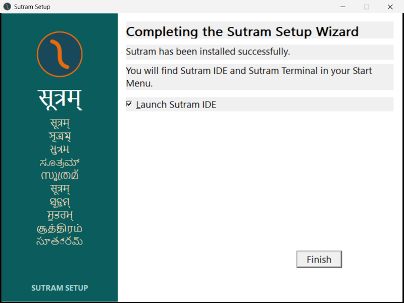

# v306 installation evidence

## Current usable state

The clean A4 installation completed at 21:49:14 local time on 2026-11-06.
Finish was observed 8.05 seconds after clicking Install. The engine log spans
21:49:07–21:49:14. The child exited without manual intervention and no visible
child console was observed. The observer closed the completed wizard normally.
Its separately held `Process.ExitCode` was unavailable (`null`), so no independently
captured numeric child exit code is claimed; Finish and the complete log were observed.



[A4 observations and actual child argv](a4.json), [engine log](a4-engine.log),
[post-install snapshot](a4-after.json), [fresh-shell identity and hashes](identity.json).
All 657 manifest entries match. The installed tree contains 662 files including
installer metadata. Existing shortcuts were preserved by the installer; their
ownership is not inferred from clean-install success.

New `cmd.exe /d /c` processes used the persisted machine and user PATH, from
`build/windows-v306-2026-11-06`, where there is no `sutram.exe` to shadow PATH:

```text
where sutram
%USERPROFILE%\AppData\Local\Programs\Sutram\bin\sutram.exe

sutram --version
Sutram 1.0 (v306) - sampurna sutra
Samskrita-mukhya bhasha -> x86-64 yantra-bhasha
```

This is a new child-shell test with persisted environment values, not a claim
that a visible terminal was manually typed into. The original A1 snapshot was
taken from the repository; its `where` output also includes the repository binary.
A5 deliberately removes that current-directory ambiguity.

## Preservation and A3

The supplied handoff predicts refusal over the canonical old installation.
Source inspection shows a different contract: `Find-OtherSutram` excludes this
installation's own bin directory, and matching ownership metadata permits
same-folder upgrades. Therefore, before risking A3, the entire original v305
installation was copied to:

```text
%USERPROFILE%\AppData\Local\Programs\Sutram-before-v306
```

All 662 original file hashes were verified against the initial snapshot; the
canonical old installation remained in place for A3. See [preserve.json](preserve.json)
and [before.json](before.json). This reverses the handoff's risky preservation
ordering while preserving its requested existing-install test.

A3 began at 21:32:31; the engine log began at 21:32:34. It did not refuse or name
an existing installation. It removed old owned payload files and began copying.
Its last engine-log entry is:

```text
[2026-11-06 21:32:45] Copied 100 of 658 files; last: docs\_newchapter_en.html
```

There were 117 files in the partial tree. The log does **not** identify the
particular copy operation that stalled. A later snapshot independently found
`docs\reports\EDGE-COVERAGE-30.md` unreadable because another process held it
open. This is separate filesystem evidence, not a per-file installer-log claim.

At 21:37–21:38 Windows reported all child PowerShell threads as suspended,
and the wizard's original threads also as suspended. Their suspension's cause
has not been established. The observer itself continued recording. No manual
suspension, fault injection or deliberate stall was performed by these scripts.
These observations do not prove a product-code deadlock.

The owner then reported ending the stalled installation in Task Manager.
The wizard was absent on the subsequent process check, while PowerShell PID
27748 remained. Consequently the automatic 15-minute termination path is
**not verified**. The observer's `NO_RESULT_AFTER_930_SECONDS` status is not an
automatic-timeout result. The exact owner termination time was not captured.

[A3 log](a3-engine.log), [observations](a3.json), [thread states](a3-thread-state.json),
[partial file list](a3-stalled-files.json), [snapshot error](a3-snapshot-error.txt),
[owner intervention](a3-user-interruption.json), [cleanup](cleanup-a3.json).

## Cleanup and fresh install

After the observation ended, cleanup verified the orphan child's PID, command
line and start time before terminating only that child. The partial canonical
tree was moved, not deleted, to:

```text
%USERPROFILE%\AppData\Local\Programs\Sutram-A3-before-clean-v306
```

Only the canonical Sutram bin entry was removed from the user's raw PATH before
A4. [path-removal.json](path-removal.json) records its before/after strings,
registry value type, removed entry and machine PATH. No machine PATH edit was
performed. A4 restored the canonical user PATH entry through the installer.
The older `Sutram-recovery-20261106-205221` backup was left untouched.

Both installer launches used the unmodified v306 setup executable under the
normal user's token. Its own child command includes `-NoProfile -NonInteractive
-ExecutionPolicy Bypass`; this is recorded verbatim in the JSON. No persistent
execution-policy change was made by this diagnostic round.

Interrupted-install recovery and the absence of per-file copy logging were
already acknowledged in REQUEST.md. Clean-install success does not establish
the A3 stall's root cause or close those known gaps.
