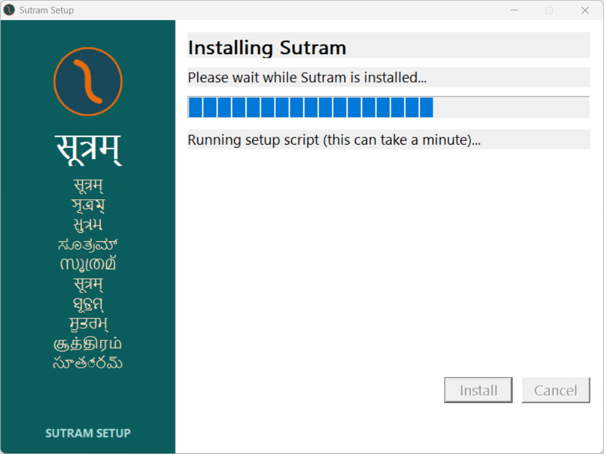

# Same-directory upgrade: Acronis suspended both processes

**Direct local log evidence identifies an external suspension.** At
`2026-11-06 22:05:53.312099` Acronis Active Protection's **Create Delete Full Read**
heuristic marked PowerShell PID **43036** suspicious and recorded that it
successfully suspended both that process and parent `Sutram-Setup.exe` PID
**42236**. Independently, the observer found all four wizard threads and all
29 child threads suspended. This run does not establish a copy-loop deadlock.

The same Acronis log records both prior-round PIDs **27748 / 36956** being
suspended at `21:32:45.270280`, matching that run's last installer progress.
This is new evidence explaining the previously unexplained suspension; the
earlier dated report remains unchanged.

## Requested upgrade table

| Question | Answer |
| --- | --- |
| Did the upgrade stall? | Yes. The same-directory v306-to-v306 upgrade stopped progressing during copying; Acronis explicitly suspended the engine and wizard. |
| Last file written, and its size | Most recently **created** file: `docs\ai-handoff-notes\REAL_MACHINE_RESULTS_2026-10-01.md`, **3,024 bytes**, created at `22:05:53.3110904`. It is readable and matches the backup hash. This is a timestamp candidate, not proof of a faulting or locked file. |
| File count at stall vs initial working installation | **107 vs 662**. The working installation and all 662 files were backed up and hash-verified before the attempt. |
| Any Defender event at the same time? | Both the during-stall and whole-observation Defender Operational queries found no matching events. The identified intervention is from **Acronis**, supported by its own log, not a Defender attribution. |
| Did the 15-minute timeout fire? | **No automatic action was observed through 937.88 seconds.** Both processes remained externally suspended and alive. This is not a runnable-wizard timeout acceptance test. |
| At what time, and what did it log? | By `22:21:18.834219-05:00`, observation and the close-request check had ended without a result. No timeout log entry or failure dialog appeared; the log still ended at `22:05:53`. |

The last live engine-log entry is:

```text
[2026-11-06 22:05:53] Copied 100 of 658 files; last: docs\_newchapter_en.html
```

That names the last **logged hundred-file checkpoint**, not the file in progress.
The source-timestamp query requested in the handoff returned **no files** in the
last two minutes. This copier preserves source LastWriteTime values: the latest
created file retains `2026-10-27T07:51:32-04:00` as its LastWriteTime. CreationTime,
the actual copy log and security events provide more useful correlation here.

`openfiles` exists, but reports that local object tracking is disabled; its
remote-share query returned access denied. No handle.exe was found. The eight
most recently created files all opened for read with read/write/delete sharing.
No handle owner or blocking file lock was established. The previous round's
unreadable `EDGE-COVERAGE-30.md` was not reproduced as this run's last-file candidate.

## Screenshot and evidence



This is the existing wizard's DWM-rendered window content, captured through a
temporary preview because its suspended UI cannot service PrintWindow. The final
image was visually inspected. It is not a generated or reconstructed mockup.

- [Engine log at first stall](engine-at-stall.log), [final engine log](engine.log)
- [Full timed observations and child argv](upgrade.json)
- [Threads still suspended after the deadline](after-deadline-threads.json)
- [Process/thread/file snapshot](stall.json), [recent-file read checks](recent-file-access.json)
- [Candidate file and backup hashes](latest-file-hash.json)
- [Acronis suspension records with surrounding context](security-log-excerpts.json), [four suspension actions](security-actions.json)
- [Defender query during stall](defender-during-stall.json), [whole-observation query](defender-events.json)
- [Verified backup inventory](preserve.json), [capture provenance](dwm-screenshot.json)

The installed `install.log` captured during the stall is the older completed
installation's log; it is saved as `installed-log-at-stall.log` and must not be
mistaken for this attempt's live log in `%TEMP%\STM7E.tmp\install.log`.

## Interpretation and machine recovery

The security log calls the behavior suspected malware. That is Acronis's heuristic
verdict, not a claim here that Sutram contains malware. Its detection coincides
with the upgrade's delete/recreate activity, and explicitly explains why both
processes stopped executing. An in-process watchdog cannot execute while its
own process remains externally suspended. This case must not be presented as
proof that the ordinary runnable-engine timeout branch is broken or accepted.

No security process was stopped, no exclusion or trust rule was added, and no
suspended installer was resumed. After the complete observation, recovery verified
the two test-owned PIDs, command/image identities and creation times before
terminating them. The 107-file partial tree was moved to
`%LOCALAPPDATA%\Programs\Sutram-followup-partial-20261106`.

The working installation was restored from
`%LOCALAPPDATA%\Programs\Sutram-before-v306-followup-20261106`.
**All 662 restored file hashes match the pre-test backup; the installed v306 CLI
exits 0; user and machine PATH are unchanged.** The backup and partial tree are
both retained. [restore.json](restore.json) records this recovery verification.
This was restoration after a destructive upgrade test, not another clean-install
acceptance round. The tests used unmodified v306 product and installer bytes;
system protection settings remain unchanged. A concurrent upstream v307 update
was integrated into the repository only after measurement, as recorded in
[COMMANDS.md](COMMANDS.md); it was not installed or tested in this round.
