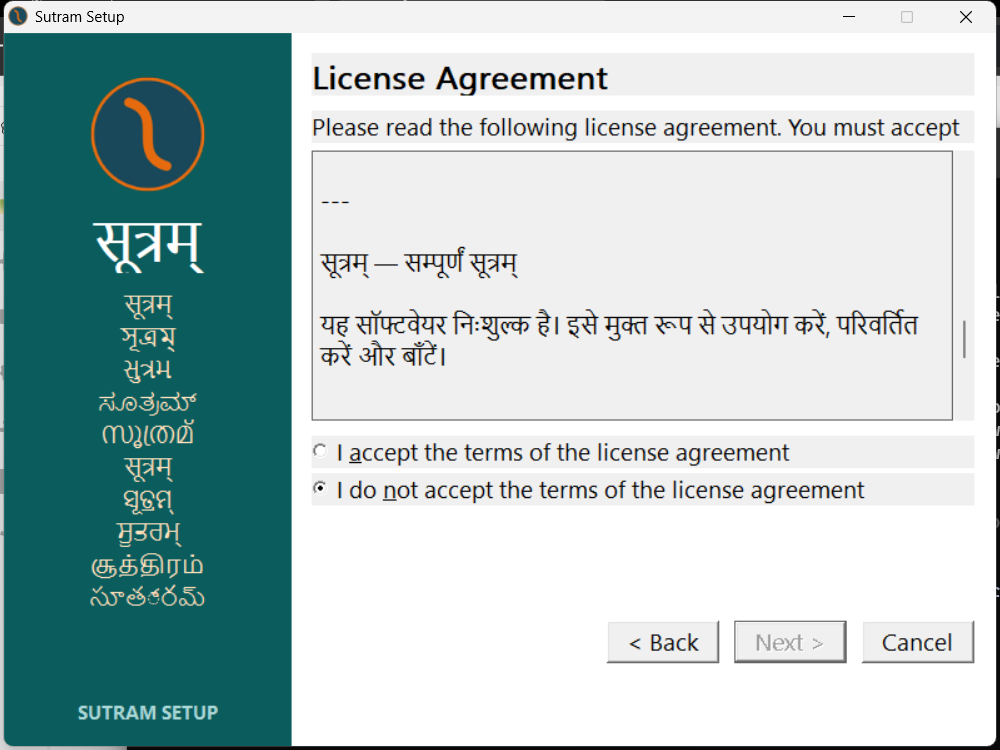

# v312 licence page — native Windows observation

The em dash, line breaks and Devanagari rendering are fixed in the tested setup. A separate instruction label still clips at the right edge. This is a display observation, not a language-accuracy review.

| Question | Answer | Result |
| --- | --- | --- |
| A2.1 — one em dash or three characters? | One em dash (U+2014), visibly correct in the heading and Sanskrit line. | PASS |
| A2.2 — lines broken or joined? | Broken correctly, including blank lines. The captured control text exactly equals the source licence with CR LF line endings. | PASS |
| A2.3 — Sanskrit present and rendered? | Yes: `सूत्रम् — सम्पूर्णं सूत्रम्` renders as Devanagari. The following Hindi paragraph also renders as Devanagari. No replacement boxes, wrong Latin letters or missing line observed. | PASS |
| A2.4 — any text truncated at the right edge? | Yes, the instruction above the licence edit control ends visibly at “You must accept”; its underlying text continues “the terms to continue.” No right-edge truncation observed in the captured licence body; its text wraps. | **FAIL for the full page** |

The control reports Segoe UI, logical height -19, through WM_GETFONT/GetObjectW. Windows can select fallback glyph fonts; this does not identify every rendered glyph's font. The untouched text file read from the control contains 34 CR LF breaks; the control reports 49 display lines after wrapping. The screenshot is the full 1000 × 750 setup window at this machine's existing display configuration.

Captured before accepting or advancing: [top](capture-retry-licence-top.png), [middle](capture-retry-licence-middle.png), [Sanskrit/Hindi](capture-retry-licence-sanskrit.png), [bottom](capture-retry-licence-bottom.png). [Exact UTF-8 text extracted from the UTF-16 control](capture-retry-licence.txt). [Capture/process record](capture-retry-install.json). The same rendering was captured before [reinstall](reinstall-licence-sanskrit.png).

An earlier wizard yielded valid top/middle/bottom captures, then changed to the location page and closed outside the automation's scripted actions. The five supplemental captures from that attempt show the location page and are **not evidence of licence rendering**. The cause of that navigation is not established. The installer was reopened; the valid captures linked above were inspected before continuation. Invalid attempts remain local and are excluded from the published evidence manifest. See COMMANDS.md.
