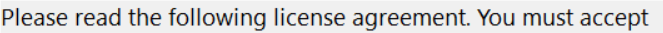

# Licence instruction — pre-fix evidence; v313 unavailable

**These are new measurements of the available v312 setup, not v313 acceptance.** The wizard was opened only to the licence page, captured and closed without accepting or installing. Its SHA-256 is `2356014dc0e66b1de1dabe3f868e55b7b73b1c3e17ad231802b2dbb5592643d6`. This is the newer v312 repack on main; it is not the setup hash from the earlier v312 acceptance run.

## A1–A2: exact display and missing words

Visible text in the [full page](prefixed-licence-default.png) and [exact instruction-control crop](prefixed-instruction-crop.png):

> Please read the following license agreement. You must accept

Full source/control text:

> Please read the following license agreement. You must accept the terms to continue.

Missing from the display: **“the terms to continue.”** The label is **above the licence body**, not at the bottom as the brief describes. Its source is `b_lichead` in `windows/native-installer/sutram_wizard.asm`; LICENSE.txt contains the body, not this instruction.

The default window is 1000 × 750 screen pixels; the label's screen rectangle is 663 × 33 pixels. The source allocates **530 × 26 logical pixels**, at y=62; the licence body begins at y=94. [Source excerpt](label-source.txt), [capture/process/geometry record](label-capture.json).

At the source's Segoe UI height -19 and weight 400, a local GDI calculation measures the full line as **709 pixels wide**. At width 530 it requires **two lines / 50 pixels of height**. This is a source-based layout model, not a measured repair: increase label height and move/resize the following body to keep them from overlapping. The source offers only 32 pixels from the label's top to the body's top. [Model and exact metrics](label-layout-model.json), [reproduction](label-layout-model.ps1).

The first cross-process GDI attempt did not check SelectObject success and produced a result inconsistent with the visible clipping. Its `gdi_metrics` remain in the raw capture record but are **not accepted evidence**. The separate model creates and validates its own font; the screenshot, full WM_GETTEXT text and window rectangles are the native observations.

## A3: two sizes after the fix

**NOT RUN — no v313 package is available.** The current wizard also has no resizable border. When the fix arrives, test its default size and a supported narrower size; if it is still fixed-size, document that and distinguish an API-forced width from normal user resizing. Neither a source layout calculation nor a forced size of the unfixed v312 wizard proves the v313 criterion.
